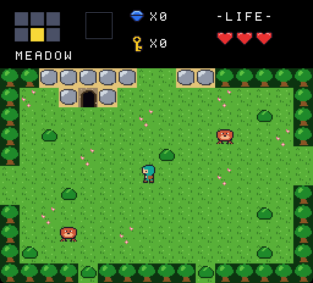

# Little Quest

Little Quest is a small game in the style of the original *The Legend of Zelda*, written in Rust on [GPUI](https://gpui.rs/), the UI framework behind the [Zed](https://zed.dev/) editor. It shows what GPUI looks like away from text editing: a fixed 60 Hz game loop, held-key input, crisp pixel art, and a HUD built with flex layout.

It's a fan homage with original art, and it isn't affiliated with Nintendo.



*The built-in bot playing, recorded from the game window. Its full run takes 42 seconds, and this cut takes 17.*

## Play

```sh
git clone https://github.com/scroix/little-quest.git
cd little-quest
cargo run --release
```

The first build compiles all of GPUI, so it takes a while. Later builds take seconds.

You start with no sword. Take one from the cave, find the dungeon, win the key from its second room, open the locked door, beat the boss, and take the relic.

- Arrow keys or WASD move. The most recently pressed direction wins.
- Space, Z, or X stabs with the sword. At full hearts, a stab also fires a beam.
- Facing a rock blocks it with your shield, unless you're mid-stab.
- Enter starts the game, and restarts it after game over or victory.
- Cmd-Q quits. The game pauses when its window loses focus.

The game has only been run on macOS on Apple Silicon, with Rust 1.97 and Xcode 27. GPUI also targets Linux and Windows, but nobody has tried this game there.

You don't need Xcode's Metal Toolchain component, because `Cargo.toml` enables GPUI's `runtime_shaders` feature, which compiles the shaders at launch instead of at build time.

## What it shows about GPUI

Only `src/view.rs` and `src/main.rs` import GPUI, so those are the two files to read.

- **Game loop.** `on_frame` reschedules itself with `cx.on_next_frame`, runs whichever 60 Hz ticks are due, and calls `cx.notify()` only if a tick ran. GPUI redraws only when notified, so `render` only reads game state, and a paused game stops redrawing.
- **Pixel art.** GPUI samples images with a linear filter, so a sprite blurs at any other size or at a fractional position. The view scales each sprite by nearest neighbor to exact device pixels, caches it as a `RenderImage`, and draws the world with `paint_image` in a `canvas`. A content mask keeps sliding rooms inside the playfield.
- **Images over quads.** A room is 45,056 pixels. In a rough test, 15,000 `paint_quad` calls took about 21 ms a frame, which misses 60 Hz, and 200 `paint_image` calls took about 0.1 ms. A screen needs about 200 draws.
- **Keyboard.** `on_key_down` and `on_key_up` on a focused root `div` feed a small held-key struct. `observe_window_activation` clears it when the window loses focus, so keys can't stick.
- **HUD.** The minimap, item box, counters, and hearts are flex `div`s and `img` elements. Text is a row of bitmap font glyphs.
- **App behavior.** GPUI doesn't provide Cmd-Q or quit when the last window closes, so `src/main.rs` adds a Quit action, a key binding, a menu item, and an `on_window_closed` handler.
- **Covered windows.** GPUI stops its display link while a window is fully covered, so `on_next_frame` stops firing. Normal play is already paused by then, but `--demo` stalls until part of its window is visible.

## How the game is organized

The rules don't depend on GPUI. `Game::tick` in `src/game.rs` takes one tick of input and advances a `Mode` state machine, and `Game::scene` in `src/game/scene.rs` returns a flat list of sprites to draw. That split lets `cargo test` play the whole game with no window.

Rooms are ASCII maps in `src/world.rs`, enemy stats and AI are in `src/actors.rs`, and sprites are text grids in `src/sprites/art.rs`. The GIF above is the only image file in the repository.

## Other commands

```sh
cargo test                       # rule tests, including a bot that wins the whole game
cargo run --release -- --demo    # watch the bot play, without taking keyboard focus
cargo run --example snapshot     # write a sprite sheet and every room to target/snapshots/
```

The game also accepts `--seed N` to fix the random seed, and `--log` to print mode changes and frame timing to stderr.

On macOS, after `cargo build --release`, `python3 scripts/capture_demo.py` runs the bot and saves screenshots of its window to `target/captures/`. `cargo run --release --example check_capture -- <file>` then checks that a screenshot's sprites aren't blurred.

## License

[MIT](LICENSE).
